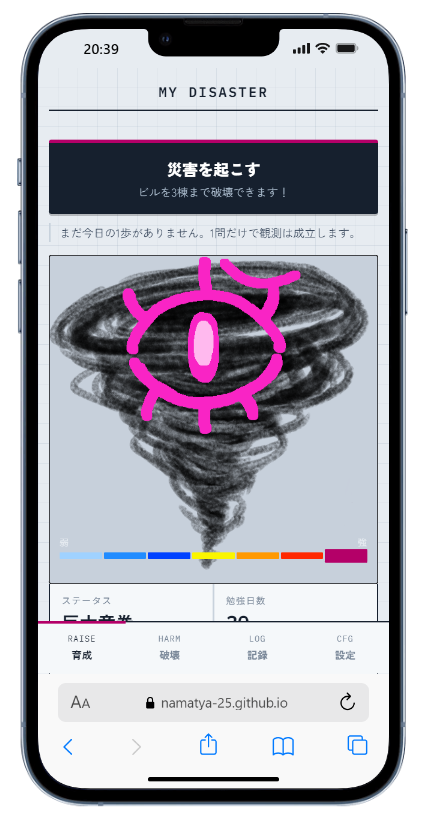

# MY DISASTER

勉強を続けるために、災害を育てよう。

資格試験などの勉強のハードルを下げる、継続サポートアプリです。
毎日の小さな勉強で「災害」が育ち、育った災害でスマホを振って街を壊せます。
勉強のプレッシャーや退屈さを、看板やビルを壊す気持ちよさで発散させます。

---

## デモ

<table>
  <tr>
    <td></td>
    <td valign="middle">
      <b><a href="https://namatya-25.github.io/continuation-app/">https://namatya-25.github.io/continuation-app/</a></b>
      <br><br>
      
      <br><br>
      📱 スマホで開いて、端末を振ってみてください
    </td>
  </tr>
</table>

### デモ動画

https://github.com/user-attachments/assets/cfedd5b0-9a39-43d3-a4d7-b785d4100247

---

## 基本的な操作

1. 目標（取りたい資格など）を設定する
2. 「1日1ページ参考書を読む」くらいの小さなタスクを終えたら、ボタンを押して記録する
3. 毎日続けると災害が育ち、レベルが上がる
4. レベルが上がると、壊せるものが増える（看板 → 自転車 → 車 → 民家 → 商店 → 商店街 → ビル）
5. スマホを振ると、街が壊れる

サボってもリセットはされません。少しずつ弱くなるだけなので、また再開すれば大丈夫です。

---

## チームと担当

3人で開発しました。

| メンバー | 担当 |
| --- | --- |
| **namatya（自分）** | アプリの土台と、続けてもらうための仕組み |
| dorabee | サウンドと、壊れるときの演出 |
| Lu | 災害キャラクターのイラストと、デザイン |

### 自分が作ったところ

- アプリ全体の土台（ファイル構成、状態管理と保存、画面の更新のしくみ）
- 連続日数・レベル計算・サボったときの弱体化（`lib/domain.js`）
- 04:00を1日の区切りにする日付判定（`lib/date.js`）
- スマホを振って壊す機能（加速度センサーによるシェイク検知、振動、解放順に壊す処理）
- 初回のチュートリアル画面
- ビルを初めて壊したときのくす玉演出
- やったことの記録機能

---

## こだわった点

**機能よりも「壊す体験」の気持ちよさ。**
勉強を続けた結果、何かを派手に壊せること自体をごほうびにしました。

- 壊す対象ごとに専用のアニメーションと効果音を用意し、壊れた後は瓦礫に変わる
- タップではなく「スマホを振る」ことで壊す。体を使うので発散した感じが出る
- 初めてビルを壊したときだけ、くす玉の演出が出る
- 壊したものは15秒で元に戻るので、何度でも壊せる

**続けやすさのための設計。**

- **1日の区切りは04:00。** 深夜0時を過ぎてからの勉強も、その日の分として数える
- **サボってもリセットしない。** 1日は猶予、2〜3日で弱体化、4日目からは1日ずつ下がる。下がるのは1階級下まで
- **データは端末の中だけに保存する。** ログイン不要で、すぐ始められる

---

## 苦労したこと

**GitHubを使ったチーム開発。**
メンバーがGitHubに慣れていなかったため、マージのミスで公開中のアプリが何度か動かなくなりました。
また、ブランチをメンバーの名前で切っていたため、同じファイルを複数人で触ることになり、コンフリクトが起きやすくなっていました。

対策として、ファイル単位で担当を分け、共有部分（`domain.js`, `main.js`）は先に仕様を決めてからなるべく触らないようにしました。
次からは、**機能ごとにブランチを切って**作業したいと考えています。

**シェイク検知の調整。**
iPhoneでは、加速度センサーを使う前にユーザーの許可が必要です。そのため、許可ボタンを用意して許可ダイアログを出すようにしました。
また、振る強さの閾値が低いと、少し動かしただけで壊れてしまいます。逆に高すぎると反応しません。実機で何度も試しながら閾値を調整しました。

---

## 使用技術

- HTML / CSS / JavaScript（ESモジュール）
- フレームワーク・ビルドツールなし
- DeviceMotion API（シェイク検知。iOSの許可ダイアログにも対応）
- Web Audio API / HTMLAudioElement（効果音）
- localStorage（データ保存）
- GitHub Pages（公開）

---

## 開発者向け

### 動かす

ESモジュールを使っているため、`index.html` をダブルクリックで開くと動きません（ブラウザがCORSでブロックします）。ローカルサーバーを立ててください。

```bash
# どれか1つ
npx serve .
python3 -m http.server 8000
npx vite            # 保存すると即反映されるのでおすすめ
```

Vite を使う場合は `npm init -y && npm i -D vite` してから `npx vite` で立ち上がります。設定ファイルは要りません。

### ファイル構成

```
index.html          画面のマークアップ
styles.css          スタイル
assets/
  tornado/          災害（竜巻）の画像 Lv別
  face/             キャラの表情画像
  se/               破壊SE（対象ごと）
docs/               README用の画像
src/
  data/
    levels.js       レベル閾値・階級・破壊対象・街の配置    ← バランス調整はここ
    copy.js         「今日の1歩」の文言・キャラのセリフ     ← 文言調整はここ
  lib/
    state.js        アプリ状態の定義
    storage.js      localStorage への読み書き（唯一の窓口）
    date.js         04:00区切りの日付判定
    domain.js       レベル計算・減衰・達成処理             ← 全員が使う。触る前に相談
  ui/
    scope.js        レーダースコープの描画
    city.js         被害区域の描画
    records.js      カレンダー・統計の描画
    sound.js        破壊SEの読み込み・再生・オンオフ
  main.js           画面更新とイベント登録
```

### 全体のルール

**状態を変えたら `persist()` → `render()` を呼ぶ。** これだけです。

```js
S.streak.currentDays += 1;   // 状態を書き換える
persist();                   // localStorage に保存
render();                    // 画面を描き直す
```

`S` は `lib/state.js` が公開しているアプリ全体の状態です。ESモジュールのライブバインディングなので、どのファイルから import しても同じ実体を見ています。

`localStorage` を直接触っていいのは `lib/storage.js` だけです。将来サーバーに移すとき、そこだけ差し替えれば済むようにしてあります。

### 動作確認

設定タブの「開発用」から操作できます。

| ボタン | 動き |
| --- | --- |
| 1日進める | 翌日にする。連続日数の判定を試せる |
| 3日サボる | 3日進める。弱体化の挙動を試せる |
| 30日分を記録する | Lv.30 巨大竜巻の状態を作る |
| すべて消す | 初期状態に戻す |

---

